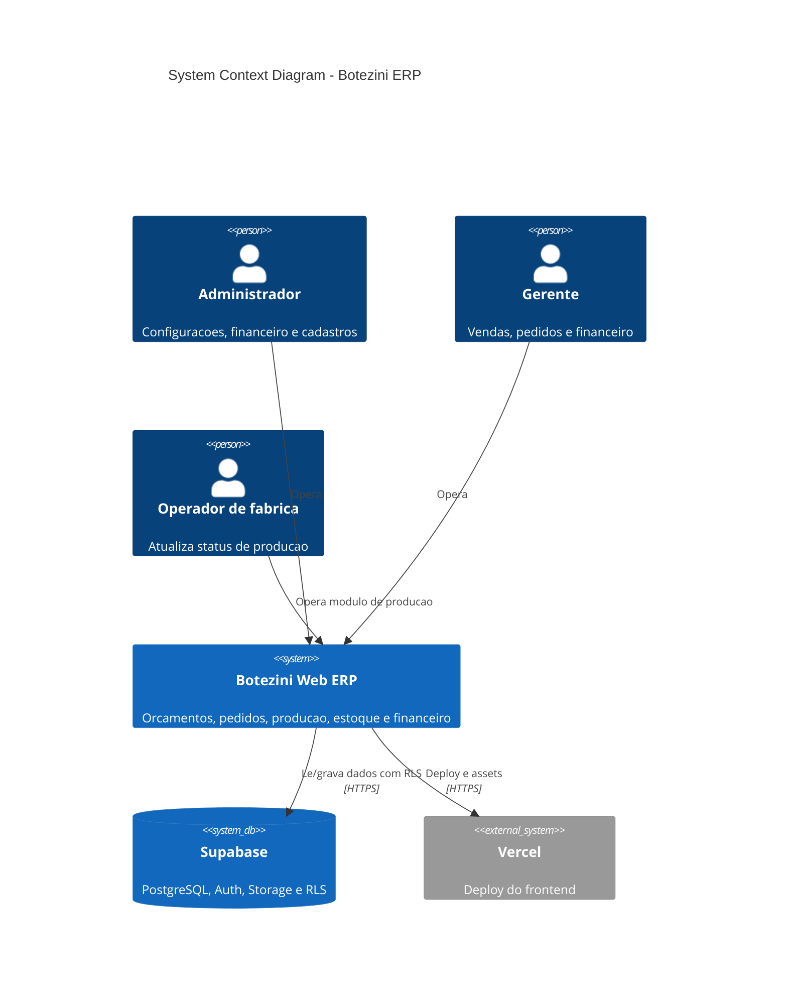

# Botezini ERP - C4 Context

## System Overview

O Botezini ERP e uma plataforma web para gerenciar orcamentos, pedidos, producao, estoque e financeiro.

O fluxo principal conecta venda, producao e financeiro: Orcamento -> Pedido -> Ordem de Producao -> Recebimento/Faturamento. O Supabase fornece autenticacao, banco PostgreSQL, RLS e storage. A Vercel hospeda o frontend.

## Personas

### Administrador
- Acesso a financeiro, cadastros, dashboard e configuracoes.

### Gerente
- Opera vendas, orcamentos, pedidos, clientes e financeiro conforme permissao.

### Operador de fabrica
- Usa o quadro de producao e fica restrito ao modulo de producao.

## External Systems

### Supabase
- PostgreSQL, Auth, Storage e RLS.
- O frontend acessa dados via `@supabase/supabase-js`.

### Vercel
- Hospedagem do app Vite/React.

## System Context Diagram

