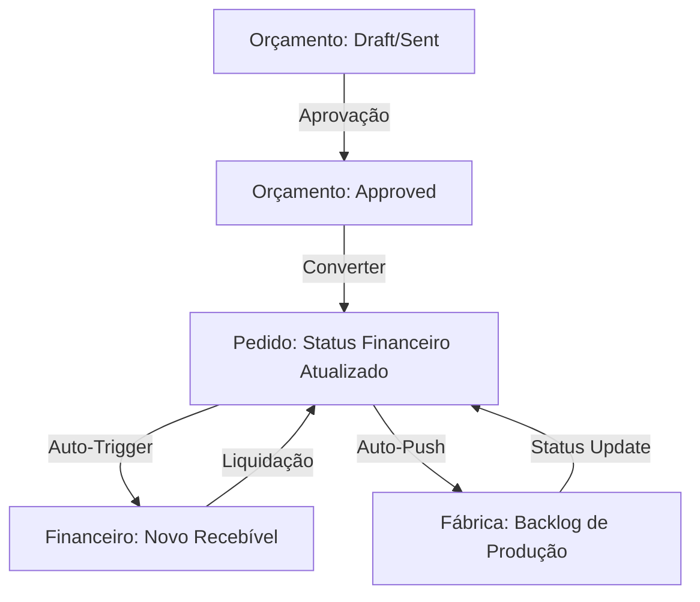

# Planejamento: Reestruturação do Fluxo de Produção e automação Financeira

Conforme solicitado, este plano detalha a interconexão entre as páginas de **Orçamento**, **Pedidos** e **Fábrica**, além da automação do **Recebimento Financeiro**.

## 1. Visão Geral do Fluxo Interconectado

---

## 2. Mudanças e Integrações Propostas

### A. Orçamentos (Budgets) → Pedidos (Orders)
- **Status 'Converted'**: Quando um orçamento é convertido, ele deve travar a edição e gerar o `Order` com todos os itens, personalizações e extras.
- **Link de Referência**: O Pedido deve manter o `budgetId` para rastreabilidade total (já existe no type, garantir na UI).

### B. Pedidos (Orders) → Fábrica (Production)
- **Sincronização em Tempo Real**: Atualmente, a Fábrica lê da tabela `orders`. A reestruturação visa:
  - **Priorização**: Adicionar um campo `priority` no Pedido que reflita imediatamente no Kanban da Fábrica.
  - **Estágios de Produção**: O Pedido deve refletir o `productionStage` atualizado pela Fábrica (Corte, Costura, etc.) para que o vendedor saiba o status exato sem perguntar à produção.

### C. Pedidos (Orders) → Financeiro (Financial Obligations)
- **Automação de Recebimento [NOVO]**:
  - Toda vez que um Pedido for salvo (`saveOrder`), o sistema deve verificar se já existe uma `FinancialObligation` de entrada (`receivable`) vinculada.
  - Se não existir, criar automaticamente uma obrigação com:
    - `description`: "Pedido #" + `orderNumber`
    - `original_amount`: `totalAmount` do pedido
    - `due_date`: Data de entrega (`deadline`) ou data atual + X dias
    - `client_id`: `clientId` do pedido
    - `notes`: Vinculado automaticamente via sistema.
  - **Empresa**: Adicionar o vínculo de empresa (user_id/tenant) para garantir que o recebível caia no caixa correto.

---

## 3. Plano de Implementação Técnica

### Fase 1: Backend & Repositories
- **OrderRepository**: Estender o método `saveOrder` para incluir o trigger de criação de obrigação financeira.
- **ProductionRepository**: Adicionar métodos para atualização em lote de estágios, afetando o status do Pedido pai.

### Fase 2: Interface (UI/UX)
- **OrderCard**: Exibir badges de status da produção (ex: "Em Costura") e status financeiro (ex: "Aguardando Sinal").
- **ProductionKanban**: Permitir ver o detalhamento financeiro básico (se o sinal foi pago) antes de iniciar a produção (trava de segurança).

### Fase 3: Automação Financeira
- Criar serviço de `FinancialTriggerService` para centralizar ações automáticas (Pedido -> Recebível).

---

---

## 4. Diretrizes de Reestilização Bruta (Padrão Finance V2)

Para que o app pareça uma unidade coesa, aplicaremos os seguintes padrões em Orçamentos, Pedidos e Fábrica:

### A. Anatomia do Card Premium
- **Fundo**: `bg-zinc-900` com borda `zinc-800`.
- **Radius**: `rounded-xl` obrigatório (fim do `rounded-sm`).
- **Labels**: `font-black text-[10px] uppercase tracking-widest text-zinc-500`.
- **Moeda**: `font-mono font-bold text-white`.

### B. Header e Filtros (The "Finance" Deck)
- Filtros rápidos em tabs (`ALL`, `PENDING`, etc.) no topo.
- Barra de busca com ícone de lupa e atalho `Ctrl+F`.
- Uso extensivo de Tooltips e GhostButtons para ações secundárias.

## 5. Próximos Passos
1. **Reestilização de Orçamentos**: Aplicar o Visual System e melhorar a conversão.
2. **Automação Financeira**: Implementar o trigger no `OrderRepository`.
3. **Dashboard de Fábrica**: Modernizar o Kanban para alta densidade.

> [!IMPORTANT]
> A implementação seguirá o padrão de **Imutabilidade Financeira** já estabelecido, onde o Pedido cria a "Obrigação" e o pagamento é um evento separado.
